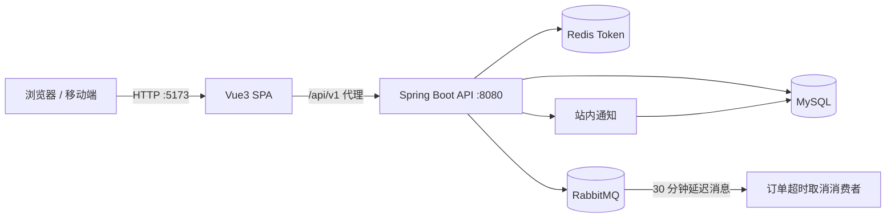

# 拾豆咖啡 · 咖啡电商与订阅平台

一个基于 **Spring Boot 3 + Vue 3** 的前后端分离全栈学习项目，覆盖「用户 → 商品 → 购物车 → 订单 → 支付 → 库存 → 订阅 → 后台运营 → 站内通知」的完整业务闭环。

前端采用咖啡品牌化的响应式设计，后端包含 JWT 鉴权、RBAC 权限、订单状态流转、库存预占与流水、RabbitMQ 延迟取消、订阅定时生成订单、模拟支付回调和站内通知等能力。

> 项目定位为学习型作品集项目。支付为模拟流程，不接入真实支付/物流；优惠券、积分、退款等不在当前实现范围内。

## 功能概览

| 模块 | 已实现能力 |
| :--- | :--- |
| 用户与认证 | 注册、登录、登出、JWT + Redis Token、个人资料、收货地址、咖啡偏好、角色权限 |
| 商品与 SKU | 商品列表/详情、关键词与烘焙度/处理法/风味筛选、多规格 SKU、库存展示 |
| 购物车 | 加购、数量修改、勾选/全选、删除、清空、金额汇总 |
| 订单 | 创建订单、订单列表/详情、状态筛选、手动取消、30 分钟超时自动取消、商品快照 |
| 支付 | 创建模拟支付单、支付回调验签与幂等、支付状态查询 |
| 库存 | 下单预占、取消释放、乐观锁防超卖、库存流水、后台库存调整 |
| 订阅 | 周/双周/月计划、创建订阅、暂停/跳过/取消、定时生成待支付订单 |
| 后台管理 | 数据看板、商品增删改查与上下架、SKU 编辑、库存管理、订单发货、订阅暂停/取消 |
| 站内通知 | 订单创建/支付/发货/取消、订阅变更、订阅订单生成自动通知，支持标记已读 |

## 技术栈

| 层 | 技术 |
| :--- | :--- |
| 前端 | Vue 3.5、Vite 7、TypeScript 5.9、Pinia 3、Vue Router 4、Element Plus 2、Axios |
| 后端 | Java 21、Spring Boot 3.5.16、Spring Security、JWT（jjwt）、MyBatis-Plus 3.5.17、Flyway |
| 数据 | MySQL 8.x、Redis、RabbitMQ |
| 文档与测试 | Springdoc OpenAPI（Swagger UI）、Bruno API 测试集合、Markdown 设计文档 |

## 架构概览



- 前端通过 Vite 将 `/api` 代理到后端，生产环境由 Nginx 反向代理。
- 认证使用 Bearer Token，Token 存入 Redis 以支持主动登出/失效。
- 订单创建写入库存流水与商品快照，超时通过 RabbitMQ 延迟队列自动取消。
- 订阅定时任务扫描到期订阅，生成待支付订单并发送通知。

## 项目结构

```text
coffee-platform/
├── backend/                 # Spring Boot 3 后端
│   ├── src/main/java/com/coffee/
│   │   ├── auth/            # 注册、登录、JWT、Security
│   │   ├── user/            # 个人资料、地址、偏好
│   │   ├── catalog/         # 商品与 SKU
│   │   ├── cart/            # 购物车
│   │   ├── order/           # 订单
│   │   ├── payment/         # 模拟支付
│   │   ├── inventory/       # 库存与流水
│   │   ├── subscription/    # 订阅
│   │   ├── admin/           # 后台看板与运营接口
│   │   ├── notification/    # 站内通知
│   │   └── common/          # 统一响应、异常、配置、工具
│   └── src/main/resources/
│       ├── db/migration/    # Flyway V1–V8
│       └── mapper/          # MyBatis XML
├── frontend/                # Vue3 前端（详见 frontend/README.md）
│   └── src/
│       ├── api/             # 按模块拆分的接口
│       ├── components/      # 公共组件
│       ├── layouts/         # 前台/后台/空白布局
│       ├── router/          # 路由与权限守卫
│       ├── stores/          # 用户/购物车/订阅/通知
│       ├── types/           # API 类型
│       └── views/           # 页面
├── docs/                    # 项目文档
├── api-tests/               # Bruno 接口测试集合
├── deploy/                  # 部署配置预留目录
├── scripts/                 # 本地脚本预留目录
└── README.md
```

## 快速开始

### 环境要求

| 依赖 | 版本要求 |
| :--- | :--- |
| JDK | 21 |
| Maven | 3.9+ |
| Node.js | >= 20.19（Vite 7 要求） |
| MySQL | 8.x |
| Redis | 7.x |
| RabbitMQ | 3.x |

### 1. 初始化数据库

```sql
CREATE DATABASE coffee_platform
  DEFAULT CHARACTER SET utf8mb4
  COLLATE utf8mb4_unicode_ci;
```

无需手动建表。后端启动时 Flyway 会自动执行 `V1` 到 `V8` 迁移。

### 2. 启动后端

```bash
cd backend
mvn spring-boot:run
```

默认端口 `8080`。可通过环境变量覆盖连接信息：

```bash
DB_PASSWORD=your_password \
REDIS_HOST=localhost \
RABBITMQ_HOST=localhost \
JWT_SECRET=your_secret \
mvn spring-boot:run
```

启动后可访问：

- Swagger UI：http://localhost:8080/swagger-ui/index.html
- API 前缀：`/api/v1`

### 3. 启动前端

```bash
cd frontend
npm install
npm run dev
```

访问 http://localhost:5173。

开发环境默认将 `/api` 代理到 `http://localhost:8080`；如需指向其他端口：

```bash
VITE_PROXY_TARGET=http://localhost:8081 npm run dev
```

> 如果 npm 缓存权限异常，可使用 `npm install --cache .npm-cache`，详见 [frontend/README.md](frontend/README.md)。

### 4. 设置管理员账号

注册用户后，在数据库中提升角色：

```sql
UPDATE user SET role = 'ADMIN' WHERE username = 'your_username';
```

重新登录后即可访问 `/admin` 后台；普通用户访问后台会被路由守卫拦截，后端管理接口也会返回 403。

## API 设计

- 统一响应：`{ "code": 0, "message": "success", "data": ..., "traceId": "..." }`
- 统一分页：`{ "records": [], "total": 0, "current": 1, "size": 10 }`
- 认证方式：`Authorization: Bearer <token>`

核心模块：

| 模块 | 代表接口 |
| :--- | :--- |
| 认证 | `POST /auth/register`、`POST /auth/login`、`POST /auth/logout` |
| 用户 | `GET/PUT /users/me`、`/users/addresses`、`/users/preference` |
| 商品 | `GET /products`、`GET /products/{id}` |
| 购物车 | `GET /cart`、`POST /cart/items`、`PUT /cart/items/{id}` |
| 订单 | `POST /orders`、`GET /orders`、`GET /orders/{orderNo}`、`POST /orders/{orderNo}/cancel` |
| 支付 | `POST /payments/{orderNo}/pay`、`POST /payments/callback` |
| 库存 | `GET /inventory/skus`、`PUT /inventory/skus/{skuId}`、`GET /inventory/logs` |
| 订阅 | `GET /subscriptions/plans`、`POST /subscriptions`、`PUT /subscriptions/{id}/pause` |
| 后台 | `/admin/dashboard`、`/admin/products`、`/admin/orders`、`/admin/subscriptions` |
| 通知 | `GET /notifications`、`PUT /notifications/{id}/read` |

完整契约见 [docs/05-API设计文档.md](docs/05-API设计文档.md)。

## 验证与质量

```bash
# 前端类型检查与生产构建
cd frontend
npm run type-check
npm run build

# 后端编译打包
cd backend
mvn -DskipTests package
```

- 前端使用 vue-tsc 严格类型检查，页面路由懒加载。
- 后端 Flyway 管理数据库版本，MyBatis-Plus 分页与乐观锁生效。
- `api-tests/` 提供覆盖认证、商品、购物车、订单、支付、库存、订阅、后台与用户的 Bruno 集合。
- 已使用真实后端 + 无头浏览器验证桌面端/移动端主要页面与核心链路。

## 文档

| 文档 | 说明 |
| :--- | :--- |
| [00-项目章程](docs/00-项目章程.md) | 项目目标、范围与角色 |
| [01-MVP范围](docs/01-MVP范围.md) | P0/P1/P2 功能优先级 |
| [02-需求规格说明书](<docs/02-需求规格说明书（SRS）.md>) | 功能与非功能需求 |
| [03-架构设计](docs/03-架构设计.md) | 分层、模块与关键流程 |
| [04-数据库设计](docs/04-数据库设计.md) | 表结构、索引与枚举 |
| [05-API设计文档](docs/05-API设计文档.md) | 接口契约与响应示例 |
| [06-前端设计](docs/06-前端设计.md) | 页面、路由、Store 与组件设计 |

## 说明与边界

- 支付为学习环境的模拟实现：前端调用后端模拟回调完成支付闭环，真实环境应由第三方服务端异步回调。
- 后台商品编辑采用「更新已有 SKU + 新增 SKU」策略，暂不支持删除已有 SKU，避免破坏购物车与订阅引用。
- 优惠券、积分、退款、真实物流不在当前 API 设计范围内。
- 创建订阅时前端按文档提交烘焙度/风味/处理法，后端目前仅持久化 `planId`，后续可扩展订阅偏好表。
